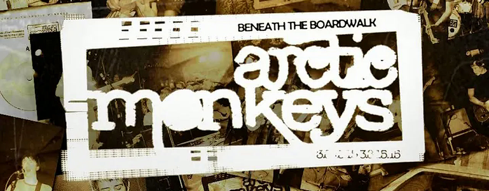
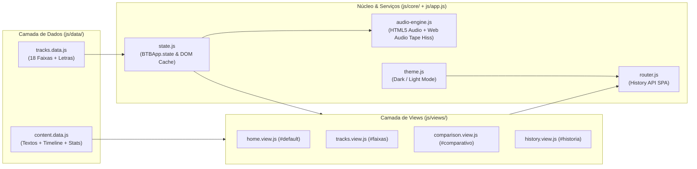

<div align="center">



<br />
<br />


# Beneath the Boardwalk (2004) — Arctic Monkeys
### Arquivo Interativo, Catálogo Comparativo & Web Audio Player (SPA)

[](https://developer.mozilla.org/pt-BR/docs/Web/HTML)
[](https://developer.mozilla.org/pt-BR/docs/Web/CSS)
[-F7DF1E?style=for-the-badge&logo=javascript&logoColor=black)](https://developer.mozilla.org/pt-BR/docs/Web/JavaScript)
[](https://developer.mozilla.org/en-US/docs/Web/API/Web_Audio_API)
[](https://getbootstrap.com/)
[](https://www.python.org/)

<p align="center">
  <em>"18 faixas cruas gravadas em Sheffield, queimadas em CD-Rs caseiros e distribuídas de graça na saída dos shows antes do primeiro contrato com a Domino Records."</em>
</p>

</div>

---

## 📌 Descrição do Projeto

### Contexto Cultural & Histórico
Antes de lançarem *Whatever People Say I Am, That's What I'm Not* (2006) — o álbum de estreia vendido mais rapidamente na história do Reino Unido —, quatro adolescentes de High Green, Sheffield (**Alex Turner**, **Jamie Cook**, **Andy Nicholson** e **Matt Helders**) gravaram suas primeiras demos no modesto **2Fly Studios** com o produtor Alan Smyth. Esses registros eram gravados em CD-Rs virgens e entregues gratuitamente ao público após os shows em pequenos pubs locais.

No final de **2004**, o fotógrafo e amigo da banda **Mark Bull (*"The Sheriff"*)** reuniu e disponibilizou essas gravações online. Batizada pelos fãs de ***Beneath the Boardwalk*** — em referência à tradicional casa de shows *The Boardwalk*, em Sheffield, onde Alex Turner trabalhava atrás do bar —, a coletânea de **18 faixas** impulsionou o fenômeno viral da banda no MySpace e contém **7 músicas inéditas que jamais foram lançadas em nenhum álbum de estúdio**.

### Objetivo como Projeto de Engenharia & Portfólio
Além de funcionar como um arquivo histórico e musical completo para fãs, este projeto foi concebido como uma **peça de portfólio de Engenharia Front-End e Processamento de Áudio**, demonstrando na prática:

1. **Arquitetura SPA sem Frameworks (*Vanilla JS Zero-Dependency Router*)**: Construção de uma *Single Page Application* fluida utilizando exclusivamente APIs nativas do navegador (`History API`, *Event Delegation* e manipulação eficiente de estado), garantindo carregamento instantâneo e zero *overhead* de *bundles* externos.
2. **Persistência de Mídia Entre Rotas**: O reprodutor de áudio inferior (*Sticky Player*) permanece instanciado fora do contêiner dinâmico de páginas, permitindo que a música continue tocando sem qualquer interrupção enquanto o usuário navega entre a tracklist, o comparativo de letras e a linha do tempo histórica.
3. **Engenharia de Áudio Híbrida (DSP Offline com `FFmpeg` + Síntese em Tempo Real via `Web Audio API`)**: Implementação do **Modo 2Fly Studio (Lo-Fi EQ)**, que recria a sonoridade analógica de fita/garagem das demos de 2004 combinando *hot-swap* sincronizado de streams com geração procedural de ruído magnético (*tape hiss*) em tempo real no navegador.

---

## ⚙️ Como o Site Funciona

A aplicação é dividida em **4 módulos funcionais (Abas SPA)** coordenados por um estado central (`state`) em `js/app.js`:

### 1. Roteamento SPA Nativo (`History API`)
- Ao clicar em qualquer item de navegação (`[data-nav="default" | "faixas" | "comparativo" | "historia"]`), o roteador intercepta o clique padrão, atualiza a URL via `window.history.pushState(?content=...)`, alterna a visibilidade das views (`.dynamic-content`) e atualiza dinamicamente o `document.title`.
- O listener `window.addEventListener("popstate")` garante suporte completo aos botões **Voltar / Avançar** do navegador e permite compartilhamento de links diretos (*deep linking*) para qualquer aba.

### 2. Motor de Áudio Contínuo & Sincronização Reativa da Interface
- O elemento `<audio id="mainAudioElement">` opera como fonte única de verdade para o tempo de execução (`timeupdate`, `loadedmetadata`, `ended`).
- Qualquer mudança de estado (Play, Pause, troca de faixa, *Shuffle* ou *Repeat One/All*) dispara a função `updatePlaybackUI()`, que sincroniza simultaneamente:
  - A **rotação física em CSS** do CD-R caseiro na vitrine principal (`#cdrDisc`) e do mini-disco na barra inferior (`#miniDisc`) via `animation-play-state`;
  - O **equalizador animado** de 4 bandas na seção Hero (`#heroEqualizer`);
  - O destaque visual da faixa em execução na lista de 18 músicas (`.track-row.active`);
  - A atualização automática do painel de letras e comparativo para a música selecionada.

### 3. Modo 2Fly Studio (Lo-Fi Garage EQ) — Como Funciona por Baixo dos Panos
Para simular com fidelidade o som de um CD-R / fita cassete saída do *2Fly Studios* em 2004 — e funcionar tanto em hospedagem web (`https://`) quanto ao abrir o arquivo localmente (`file://`, onde navegadores bloqueiam `MediaElementAudioSourceNode` por políticas de CORS) —, o sistema utiliza uma **arquitetura de duplo estágio**:

1. **Hot-Swap de Stream Sincronizado ao Milissegundo**:
   - Quando o usuário aciona o botão `Lo-Fi EQ`, a função `toggleLofiEq()` captura a posição exata da reprodução (`audio.currentTime`) e o estado atual (`isPlaying`).
   - O atributo `src` do player alterna instantaneamente entre o pacote `audio/*.mp3` (**Remaster 2023**) e o pacote `audio-lofi/*.mp3` (**Mixagem Lo-Fi EQ DSP**), retomando a reprodução exatamente do mesmo ponto sem reiniciar a música.
2. **Gerador Procedural de *Tape Hiss* (`Web Audio API`)**:
   - Em paralelo, a função `syncTapeHiss()` instancia um `AudioContext` em memória e preenche um `AudioBuffer` de 3 segundos em loop com **ruído rosa/marrom filtrado algoritmicamente** acrescido de micro-estalos estocásticos de poeira/fita.
   - Esse sinal passa por um filtro passa-banda (`BiquadFilterNode` do tipo `bandpass` centrado em `1800Hz`, `Q = 0.7`) e por um controle de ganho (`GainNode`) com transição suave (`setTargetAtTime`), acompanhando dinamicamente o volume escolhido pelo usuário e silenciando automaticamente em pausas.

### 4. Busca Instantânea, Filtros Multicritério & Inspetor Lírico
- **Na aba *As 18 Faixas* (`?content=faixas`)**: O usuário pode combinar filtros de categoria (*Todas [18]*, *Exclusivas da Demo [7]*, *Foram para o 1º Álbum [8]* e *B-Sides & EPs [3]*) com uma barra de busca em tempo real que pesquisa simultaneamente no título da demo, no título oficial rebatizado, no resumo histórico e nos versos da letra. Cada linha oferece reprodução com um clique e download direto do arquivo `.mp3`.
- **Na aba *Letras & Comparativo* (`?content=comparativo`)**: Exibe um quadro comparativo lado a lado (**📼 Demo Original 2004 vs. 💿 Catálogo Oficial Domino Records**), lista de diferenças de arranjo/censura, folha de letra estilo *fanzine* com botão de cópia (`navigator.clipboard`) e chips de atalho para as mudanças mais emblemáticas (*Riot Van*, *Cigarette Smoke*, *Scummy* e *Mardy Bum*).

### 5. Sistema de Temas Dinâmicos (`Dark / Light Mode`) sem *FOUC*
- Um script inline no `<head>` verifica a preferência salva em `localStorage` (`btb_theme`) antes da primeira renderização do DOM, aplicando `data-bs-theme="dark"` (*Boardwalk Sunset Dark*, padrão) ou `data-bs-theme="light"` (*Warm Paper Light*) sem causar *Flash of Unstyled Content*.

---

## 🛠️ Tecnologias Aplicadas & Decisões Técnicas

| Camada | Tecnologia | Aplicação no Projeto |
| :--- | :--- | :--- |
| **Marcação & Semântica** | **HTML5** | Estrutura semântica (`header`, `main`, `section`, `article`, `aside`, `footer`), atributos de acessibilidade (`aria-label`, `aria-live`, `role`) e elemento nativo `<audio preload="metadata">`. |
| **Estilização & Temas** | **CSS3 + Bootstrap 5.3.3** | Grid responsivo e utilitários do Bootstrap 5.3 combinados com um *Design System* próprio em `css/styles.css` baseado em **CSS Custom Properties** (`--sunset-orange`, `--card-bg`, `--navbar-bg`), efeitos de *glassmorphism* (`backdrop-filter: blur`), textura sutil de granulação SVG e animações `@keyframes`. |
| **Tipografia & Ícones** | **Google Fonts + Font Awesome 6.5** | Combinação tipográfica editorial: **Oswald** (títulos de impacto estilo pôster britânico), **Inter** (leitura fluida de textos longos) e **Space Mono** (timestamps, metadados técnicos e letras estilo máquina de escrever/zine). |
| **Lógica & Estado (SPA)** | **JavaScript ES6+ (Arquitetura Modular em Camadas)** | Aplicação estruturada sob o namespace `window.BTBApp` dividida em **Dados** (`js/data/`), **Estado & Serviços Core** (`js/core/`), **Views Modulares** (`js/views/`) e **Orquestrador** (`js/app.js`), mantendo o `index.html` enxuto (~220 linhas) e altamente escalável. |
| **Síntese & Áudio Web** | **HTML5 Audio + Web Audio API** | Controle completo de reprodução, *seek*, volume/mute e síntese procedural em tempo real (`AudioContext`, `AudioBuffer`, `BiquadFilterNode`, `GainNode`) para o chiado de fita analógica do Modo 2Fly Studio. |
| **Pipeline de Áudio (DSP)** | **Python 3 + `yt-dlp` + `FFmpeg`** | Automação em `scripts/recortar_faixas.py` para download da matriz remasterizada, corte exato das 18 faixas por timestamp com injeção de metadados **ID3v2** (`title`, `artist`, `album`, `track`, `date`) e renderização da cadeia de filtros DSP Lo-Fi (`highpass=f=260,equalizer=f=1450:t=q:w=1.1:g=6.5,lowpass=f=3700,aecho=0.8:0.85:24:0.16,volume=1.25`). |

---

## 🗂️ Esquema e Organização do Repositório

O repositório segue uma estrutura limpa e escalável para aplicações web estáticas, separando claramente código-fonte, ativos visuais, bancos de áudio e scripts de automação:

```text
beneath-the-boardwalk/
├── index.html                  # App Shell enxuto (~220 linhas): Cabeçalho, 4 contêineres SPA, Rodapé e Sticky Player
├── README.md                   # Documentação do projeto, arquitetura e catálogo das 18 faixas
├── .gitignore                  # Exclusão de ambientes virtuais (.venv), caches e temporários
│
├── css/
│   └── styles.css              # Design system, variáveis Dark/Light, animações do CD-R e layout
│
├── js/
│   ├── app.js                  # Orquestrador principal (inicializa views, estado, eventos e roteador)
│   ├── data/
│   │   ├── tracks.data.js      # Catálogo estruturado das 18 faixas (metadados, letras e comparativos)
│   │   └── content.data.js     # Conteúdo editorial das abas (Hero, estatísticas, filtros e linha do tempo)
│   ├── core/
│   │   ├── state.js            # Estado global reativo (BTBApp.state), cache do DOM e utilitários
│   │   ├── theme.js            # Controlador de tema Dark / Light (data-bs-theme + localStorage)
│   │   ├── router.js           # Roteador SPA nativo via History API (?content=...)
│   │   └── audio-engine.js     # Motor HTML5 Audio, Hot-Swap 2Fly Lo-Fi EQ e síntese Web Audio API
│   └── views/
│       ├── home.view.js        # Renderização modular da Aba 1: Início (#default)
│       ├── tracks.view.js      # Renderização modular da Aba 2: As 18 Faixas (#faixas)
│       ├── comparison.view.js  # Renderização modular da Aba 3: Letras & Comparativo (#comparativo)
│       └── history.view.js     # Renderização modular da Aba 4: A História (#historia)
│
├── img/
│   ├── banner-beneath-the-boardwalk.jpg # Banner panorâmico widescreen (1280x500) usado no README
│   ├── favicon.svg             # Ícone vetorial monograma "AM" (aba do navegador e navbar)
│   ├── capa-quadrada.jpg       # Arte de capa 1:1 (720x720) exibida na vitrine principal do álbum
│   ├── capa-quadrada.png       # Arte de capa 1:1 em formato PNG sem perdas
│   ├── capa-beneath-the-boardwalk.jpg   # Thumbnail original widescreen (1280x720)
│   ├── capa-beneath-the-boardwalk.png   # Thumbnail widescreen em PNG
│   └── capa-beneath-the-boardwalk.webp  # Thumbnail widescreen otimizada em WebP
│
├── audio/                      # 18 faixas MP3 (192kbps, ID3 tags) — Remaster 2023 (Hollie Taylor)
│   ├── 01-a-certain-romance.mp3
│   ├── 02-bigger-boys-and-stolen-sweethearts.mp3
│   └── ... (03 a 18)
│
├── audio-lofi/                 # 18 faixas MP3 pré-processadas com DSP — Modo 2Fly Studio (Lo-Fi EQ)
│   ├── 01-a-certain-romance.mp3
│   ├── 02-bigger-boys-and-stolen-sweethearts.mp3
│   └── ... (03 a 18)
│
└── scripts/                    # Automação em Python para download, recorte e masterização Lo-Fi
    ├── recortar_faixas.py      # Pipeline yt-dlp + FFmpeg que gera ./audio e ./audio-lofi
    └── requirements.txt        # Dependências Python (yt-dlp, imageio-ffmpeg)
```

### Diagrama de Arquitetura e Fluxo de Dados



---

## 💿 Catálogo Completo das 18 Faixas

Todas as 18 faixas do arquivo foram recortadas seguindo os timestamps exatos da remasterização de 2023 (*Hollie Taylor Remaster*):

| # | Faixa | Recorte Original | Duração | Categoria / Destino Oficial | Arquivo MP3 |
| :-: | :--- | :-: | :-: | :--- | :--- |
| **01** | **A Certain Romance** | `00:00 – 05:21` | `5:21` | 💿 1º Álbum (*WPSIATWIN*, 2006) | `audio/01-a-certain-romance.mp3` |
| **02** | **Bigger Boys and Stolen Sweethearts** | `05:21 – 08:12` | `2:51` | 🎚️ B-Side (*I Bet You Look Good on the Dancefloor*, 2005) | `audio/02-bigger-boys-and-stolen-sweethearts.mp3` |
| **03** | **Choo Choo** | `08:12 – 11:21` | `3:09` | 🔥 **Exclusiva do Beneath the Boardwalk (Inédita)** | `audio/03-choo-choo.mp3` |
| **04** | **Cigarette Smoke** | `11:21 – 14:17` | `2:56` | 🎚️ Reescrita no EP *Who the Fuck Are Arctic Monkeys?* (2006) | `audio/04-cigarette-smoke.mp3` |
| **05** | **Dancing Shoes** | `14:17 – 16:40` | `2:23` | 💿 1º Álbum (*WPSIATWIN*, 2006) | `audio/05-dancin-shoes.mp3` |
| **06** | **Fake Tales of San Francisco** | `16:40 – 19:41` | `3:01` | 💿 EP *Five Minutes with Arctic Monkeys* & 1º Álbum | `audio/06-fake-tales-of-san-francisco.mp3` |
| **07** | **Knock a Door Run** | `19:41 – 24:04` | `4:23` | 🔥 **Exclusiva do Beneath the Boardwalk (Inédita)** | `audio/07-knock-a-door-run.mp3` |
| **08** | **Mardy Bum** | `24:04 – 26:55` | `2:51` | 💿 1º Álbum (*WPSIATWIN*, 2006 — arranjo diferente) | `audio/08-mardy-bum.mp3` |
| **09** | **On the Run From the MI5** | `26:55 – 28:40` | `1:45` | 🔥 **Exclusiva do Beneath the Boardwalk (Inédita)** | `audio/09-on-the-run-from-the-mi5.mp3` |
| **10** | **Riot Van** | `28:40 – 30:54` | `2:14` | 💿 1º Álbum (*WPSIATWIN*, 2006 — letra totalmente reescrita) | `audio/10-riot-van.mp3` |
| **11** | **Scummy (When the Sun Goes Down)** | `30:54 – 34:14` | `3:20` | 💿 1º Álbum (rebatizada como *When the Sun Goes Down*) | `audio/11-scummy.mp3` |
| **12** | **Still Take You Home** | `34:14 – 37:20` | `3:06` | 💿 1º Álbum (*WPSIATWIN*, 2006) | `audio/12-still-take-you-home.mp3` |
| **13** | **Wavin' Bye to the Train or the Bus** | `37:20 – 40:22` | `3:02` | 🔥 **Exclusiva do Beneath the Boardwalk (Inédita)** | `audio/13-wavin-bye-to-the-train-or-the-bus.mp3` |
| **14** | **Bet You Look Good on the Dancefloor** | `40:22 – 43:14` | `2:52` | 💿 Single #1 no UK (2005) & 1º Álbum | `audio/14-bet-you-look-good-on-the-dancefloor.mp3` |
| **15** | **Stickin' to the Floor** | `43:14 – 45:10` | `1:56` | 🎚️ B-Side (*When the Sun Goes Down*, 2006) | `audio/15-stickin-to-the-floor.mp3` |
| **16** | **Space Invaders** | `45:10 – 47:50` | `2:40` | 🔥 **Exclusiva do Beneath the Boardwalk (Inédita)** | `audio/16-space-invaders.mp3` |
| **17** | **Curtains Closed** | `47:50 – 49:59` | `2:09` | 🔥 **Exclusiva do Beneath the Boardwalk (Inédita)** | `audio/17-curtains-closed.mp3` |
| **18** | **Ravey Ravey Ravey Club (live)** | `49:59 – 52:03` | `2:04` | 🔥 **Exclusiva do Beneath the Boardwalk (Inédita)** | `audio/18-ravey-ravey-ravey-club.mp3` |

---

## 🚀 Como Executar Localmente

### 1. Executar a Aplicação Web
Como todas as 18 faixas (`audio/` e `audio-lofi/`) já estão processadas no repositório e a aplicação não requer etapa de *build*, basta clonar o repositório e servi-lo:

```bash
# Clone o repositório
git clone https://github.com/SEU-USUARIO/beneath-the-boardwalk.git
cd beneath-the-boardwalk

# Inicie um servidor HTTP local (recomendado para suporte completo à History API)
python3 -m http.server 8000
```

Acesse `http://localhost:8000` no navegador (ou abra o arquivo `index.html` diretamente).

### 2. Reprocessar os Áudios via Pipeline Python (Opcional)
Caso deseje regerar os recortes MP3 e a masterização Lo-Fi a partir da fonte original:

```bash
python3 -m venv .venv
source .venv/bin/activate
pip install -r scripts/requirements.txt
python3 scripts/recortar_faixas.py
```

---

<div align="center">
  <sub>Desenvolvido como projeto de portfólio Front-End & Arquivo Musical • Tributo às demos de 2004 em Sheffield</sub>
</div>
